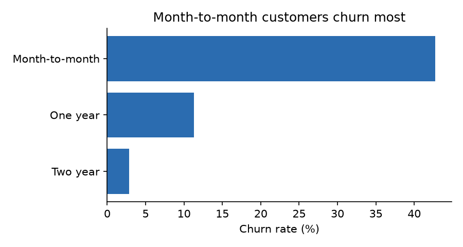
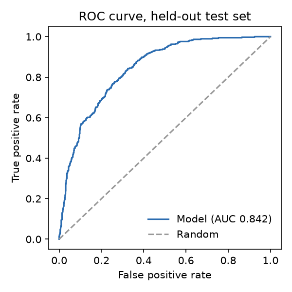

# Telecom Churn Platform


End-to-end data and ML system for predicting which telecom customers will cancel, built to
production habits: a normalized SQL warehouse, a validated ETL pipeline, a model with a
quality gate, a FastAPI service with prediction logging and drift monitoring, a guarded
natural-language analytics agent, Docker, CI/CD, and a keyless deploy to Google Cloud Run.

Live API: https://churn-platform-lst4y7dycq-pd.a.run.app/docs

## Architecture

```
 raw CSV ──► ETL (extract → validate → transform → load) ──► SQL warehouse (SQLite / PostgreSQL)
                                                                │
                     ┌──────────────────────────────────────────┼─────────────────────┐
                     ▼                                          ▼                     ▼
           training (CV model selection)            FastAPI service          analytics agent
           ── model.joblib + metrics                 /predict, /customers     question → LLM → SQL
           ── reference stats ─────────────────────► /monitoring/drift        → guardrails → read-only
                                                      prediction_log table      query → plain-English answer

 GitHub Actions: lint → tests (incl. model quality gate) → ETL on PostgreSQL → Docker build + smoke test
 Manual deploy:  Workload Identity (no keys) → Artifact Registry → Cloud Run (Toronto)
```

## Results (held-out test set, 1,409 customers)

| Metric | Value |
|---|---|
| ROC-AUC | 0.842 (5-fold CV 0.846 ± 0.012) |
| PR-AUC | 0.633 (base churn rate 26.5%) |
| Lift in top-scored 10% | 2.85× |
| Selected model | Logistic regression (beat gradient boosting in CV: 0.846 vs 0.844) |

Findings:

- Month-to-month customers churn at **42.7%**, versus 11.3% on one-year and 2.8% on two-year contracts.
- Fiber customers account for most lost revenue: **40.3%** of fiber monthly revenue belongs to churned customers.
- Churn is **54.3%** in the first 6 months and falls to 9.6% after 4 years.
- Tech support is associated with much lower churn: 22.6% vs 49.4% for fiber customers
  (an association in historical data, not proof that adding support causes retention).

## Known limitations
 
- On Cloud Run the database lives inside the container, so the prediction log resets when it restarts.
  The fix would be a managed database (Cloud SQL); the code already runs on PostgreSQL.
- The dataset is a single snapshot with no dates, so I can't test the model on "future" customers.




## Run it

```bash
pip install -e ".[dev,agent]"
python -m churn.etl                          # build the warehouse
python -m churn.etl --query sql/analysis.sql # business questions in SQL
python -m churn.train                        # train, compare, save model + charts
uvicorn churn.api:app --reload               # http://localhost:8000/docs
pytest -q                                    # 24 tests
```

PostgreSQL stack instead of SQLite: `docker compose up --build`.

Analytics agent (optional, needs an API key):

```bash
export ANTHROPIC_API_KEY=...
python -m churn.agent "What share of fiber revenue comes from customers who churned?"
```

## Deploy

See [`deploy/gcp-setup.md`](deploy/gcp-setup.md), then run the **Deploy to Google Cloud Run** workflow.

## Data

IBM Telco Customer Churn sample dataset (7,043 customers), from
[IBM/telco-customer-churn-on-icp4d](https://github.com/IBM/telco-customer-churn-on-icp4d), Apache-2.0.
